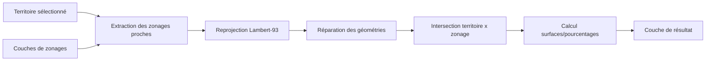
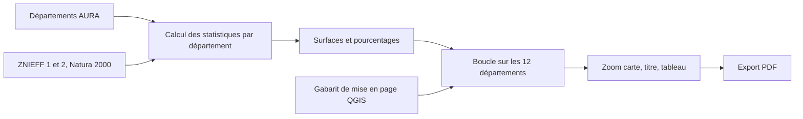

# Module 1 — Algorithme d’analyse de zonages protégés

**Statut : 🟢 version 1 fonctionnelle**

## Objectif
Algorithme de traitement QGIS (PyQGIS) qui, pour un territoire donné en Auvergne-Rhône-Alpes, identifie les zonages protégés qui le recoupent (ZNIEFF, Natura 2000, etc.) et calcule les surfaces concernées.
Données : DREAL AURA via datARA.

## Architecture



## Stack
- QGIS 3.x / PyQGIS
- Python 3

## Utilisation

### Prérequis
- QGIS 3.40+ avec PyQGIS
- Le dossier `src/scripts_traitement` ajouté dans
  `Préférences > Options > Traitement > Fournisseurs > Scripts`
- Les données téléchargées et placées dans `data/raw/` (voir section Données)

### Étapes

1. **Nettoyer le projet.** Avant toute exécution, vérifier qu'aucune couche
   résultant d'un essai précédent (nommée par défaut « Zonages recoupés »)
   n'est encore chargée dans le panneau des couches. La supprimer si besoin
   (clic droit > Supprimer la couche).

2. **Charger les données sources.** Glisser-déposer dans QGIS :
   - la couche du territoire (ex : `communes_73.geojson`)
   - les couches de zonages à analyser (ZNIEFF type 1, ZNIEFF type 2,
     Natura 2000 habitats, Natura 2000 oiseaux)

3. **Sélectionner le territoire d'étude.** Activer la couche de communes,
   utiliser l'outil « Sélectionner une entité » et cliquer sur la ou les
   commune(s) à analyser (surlignée(s) en jaune).

4. **Lancer l'outil.** Boîte à outils de traitements (`Ctrl+Alt+T`) >
   Scripts > Biodiversité AURA > *Zonages protégés d'un territoire*.

5. **Renseigner les paramètres :**
   - *Territoire* : la couche de communes, avec la case
     **« Entité(s) sélectionnée(s) uniquement »** cochée
   - *Couches de zonages* : cocher **uniquement** les couches sources
     (ne jamais inclure une couche de résultat d'un essai précédent)
   - *Zonages recoupés* : laisser « Créer une couche temporaire »

6. **Exécuter**, puis vérifier dans l'onglet Journal que la surface du
   territoire affichée est cohérente avec la zone sélectionnée.

7. **Contrôler le résultat** dans la table attributaire de la couche
   produite : un site = une ligne, avec un `pct_territoire` plausible
   (entre 0 et 100).

## Limites connues :

Pourcentage calculé par rapport à chaque commune individuellement ;
Esquilles filtrées sous 1 m²

## Exemple de résultat :


# Module 2 — Fiches diagnostic départementales

<!-- **Statut : 🟢 version 1 fonctionnelle** *(à ajuster selon l'avancement)* -->
**Statut : 🚧 En cours de développement**

## Objectif

Générer automatiquement, pour chacun des **12 départements d'Auvergne-Rhône-Alpes**, une fiche PDF d'une page contenant :

- une **carte** du département, avec les zonages de protection de la biodiversité (ZNIEFF, Natura 2000) ;
- un **tableau de synthèse** : pour chaque type de zonage, la surface couverte (en hectares) et la part du département concernée (en %) ;
- la **source des données** et la licence.

Une seule commande produit les 12 fiches, sans ouvrir l'interface de QGIS.

## Exemple de résultat 

<!--  -->

[](docs/exemples/fiche_73_Savoie.pdf)

*Cliquer sur l'image pour ouvrir le PDF.*


## Fonctionnement


1. **Calcul des statistiques** (`calcul_stats_departements.py`) : pour chaque département et chaque couche de zonage, le script extrait les sites qui le touchent, reprojette en Lambert-93 (EPSG:2154) pour obtenir des surfaces en m², répare les géométries invalides, découpe les sites par le contour du département et fusionne le résultat. Il en déduit la surface totale et le pourcentage du département couvert.
2. **Génération des fiches** (`generer_fiches_pdf.py`) : le script ouvre un projet QGIS qui contient une mise en page préparée à la main (le *gabarit*), puis, pour chaque département, zoome la carte sur son emprise, met à jour le titre, remplit le tableau avec ses statistiques et exporte le tout en PDF.

## Architecture

```
src/fiches_departements/
├── calcul_stats_departements.py   # calculs géospatiaux (retourne une liste de statistiques)
└── generer_fiches_pdf.py          # pilotage de la mise en page et export PDF
qgis/
└── gabarit_fiche.qgz              # projet QGIS : couches + mise en page « fiche_departement »
outputs/fiches/                    # PDF générés (ignorés par Git)
docs/exemples/                     # exemples de fiches pour la documentation
```

Le gabarit est construit **à la main** dans QGIS (disposition, police, légende, échelle, boussole). Le script ne dessine rien : il pilote trois éléments identifiés par leur Id.

| Élément | Id attendu | Rôle |
|---|---|---|
| Carte | `carte_principale` | zoomée sur chaque département |
| Étiquette | `titre` | nom du département |
| Tableau attributaire | `tableau_stats` | statistiques du département |

## Stack

- QGIS 3.40 LTR, Python 3.12
- PyQGIS : projet, mise en page (`QgsLayout`), export (`QgsLayoutExporter`)
- Processing QGIS : outils natifs (`native:intersection`, `native:dissolve`, etc.)

## Données

Les données sont à télécharger dans `data/raw/` (dossier ignoré par Git).

| Donnée | Source | Nom de la couche dans le projet |
|---|---|---|
| Contours des départements | IGN (Admin Express), via [gregoiredavid/france-geojson](https://github.com/gregoiredavid/france-geojson) | `departements-auvergne-rhone-alpes` |
| ZNIEFF de type 1 | DREAL AURA, catalogue datARA | `ZNIEFF_Type1` |
| ZNIEFF de type 2 | DREAL AURA, catalogue datARA | `ZNIEFF_Type2` |
| Natura 2000, directive habitats | DREAL AURA, catalogue datARA | `ZonesNatura2000_DirHabitats` |
| Natura 2000, directive oiseaux | DREAL AURA, catalogue datARA | `ZonesNatura2000_DirOiseaux` |

Toutes ces données sont sous **Licence Ouverte (Etalab)**. Les noms de couches ci-dessus doivent être respectés dans le projet QGIS, car le script retrouve les couches par leur nom.

## Utilisation

**Prérequis** : QGIS 3.40 LTR (Windows).

1. Télécharger les données (voir ci-dessus) dans `data/raw/`.
2. Vérifier que `qgis/gabarit_fiche.qgz` s'ouvre avec toutes les couches chargées. Si besoin, réattacher les chemins vers `data/raw/`.
3. Si QGIS n'est pas installé dans `C:\Program Files\QGIS 3.40.15`, adapter le chemin dans le bloc `__main__` de `generer_fiches_pdf.py`.
4. Depuis un invite de commandes :

```
"C:\Program Files\QGIS 3.40.15\bin\python-qgis-ltr.bat" "<chemin du repo>\src\fiches_departements\generer_fiches_pdf.py"
```

Les fiches sont créées dans `outputs/fiches/`, sous la forme `fiche_<code>_<département>.pdf`.

> Ne pas enregistrer le projet `.qgz` après un lancement depuis la console QGIS : le script y modifie l'état de la mise en page.

## Limites connues 

- **Contours simplifiés** : les contours départementaux du dépôt utilisé sont simplifiés pour alléger les fichiers. Les pourcentages sont donc très légèrement approximatifs près des limites.
- **Chevauchements** : ZNIEFF et Natura 2000 se superposent en partie. Les pourcentages des quatre lignes du tableau ne s'additionnent donc pas.
- **Gabarit manuel** : la mise en page est préparée dans l'interface de QGIS. Le script dépend des noms de couches et des Id d'éléments décrits plus haut.
- **Données figées** : les zonages sont ceux téléchargés à une date donnée, sans mise à jour automatique.
- **Environnement testé** : Windows et QGIS 3.40 LTR uniquement.

## Pistes d'évolution

- Fusionner les 12 PDF en un atlas unique.
- Rendre le chemin d'installation de QGIS configurable.
- Ajouter une fiche à l'échelle d'une commune, en réutilisant le module 1.
