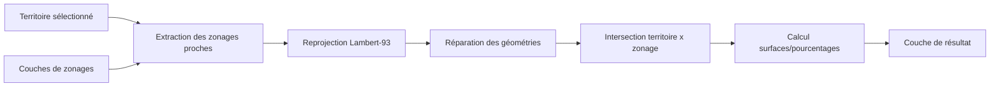

# Module 1 — Algorithme d’analyse de zonages protégés

## Objectif
Algorithme de traitement QGIS (PyQGIS) qui, pour un territoire donné en Auvergne-Rhône-Alpes, identifie les zonages protégés qui le recoupent (ZNIEFF, Natura 2000, etc.) et calcule les surfaces concernées.
Données : DREAL AURA via datARA.

## Architecture

## Stack
- QGIS 3.x / PyQGIS
- Python 3

## Utilisation

### Prérequis
- QGIS 3.40+ avec PyQGIS
- Le dossier `src/scripts_traitement` ajouté dans
  `Préférences > Options > Traitement > Fournisseurs > Scripts`
- Les données téléchargées et placées dans `data/raw/` (voir section Données)

### Étapes

1. **Nettoyer le projet.** Avant toute exécution, vérifier qu'aucune couche
   résultant d'un essai précédent (nommée par défaut « Zonages recoupés »)
   n'est encore chargée dans le panneau des couches. La supprimer si besoin
   (clic droit > Supprimer la couche).

2. **Charger les données sources.** Glisser-déposer dans QGIS :
   - la couche du territoire (ex : `communes_73.geojson`)
   - les couches de zonages à analyser (ZNIEFF type 1, ZNIEFF type 2,
     Natura 2000 habitats, Natura 2000 oiseaux)

3. **Sélectionner le territoire d'étude.** Activer la couche de communes,
   utiliser l'outil « Sélectionner une entité » et cliquer sur la ou les
   commune(s) à analyser (surlignée(s) en jaune).

4. **Lancer l'outil.** Boîte à outils de traitements (`Ctrl+Alt+T`) >
   Scripts > Biodiversité AURA > *Zonages protégés d'un territoire*.

5. **Renseigner les paramètres :**
   - *Territoire* : la couche de communes, avec la case
     **« Entité(s) sélectionnée(s) uniquement »** cochée
   - *Couches de zonages* : cocher **uniquement** les couches sources
     (ne jamais inclure une couche de résultat d'un essai précédent)
   - *Zonages recoupés* : laisser « Créer une couche temporaire »

6. **Exécuter**, puis vérifier dans l'onglet Journal que la surface du
   territoire affichée est cohérente avec la zone sélectionnée.

7. **Contrôler le résultat** dans la table attributaire de la couche
   produite : un site = une ligne, avec un `pct_territoire` plausible
   (entre 0 et 100).

## Limites connues :

Pourcentage calculé par rapport à chaque commune individuellement ;
Esquilles filtrées sous 1 m²

## Exemple de résultat :

# Module 2 — Génération automatique de fiches diagnostic départementales

## Statut
🚧 En cours de développement

## Objectif
Algorithme qui génère automatiquement, pour chaque département d’AURA, une fiche PDF avec carte et statistiques de recouvrement par les zonages protégés (mise en page cartographique automatisée).

## Architecture
🚧 En cours de développement

## Stack
🚧 En cours de développement

## Utilisation
🚧 En cours de développement

## Limites connues 
🚧 En cours de développement

# Exemple de résultat 

