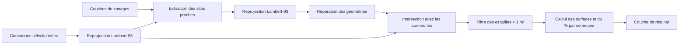
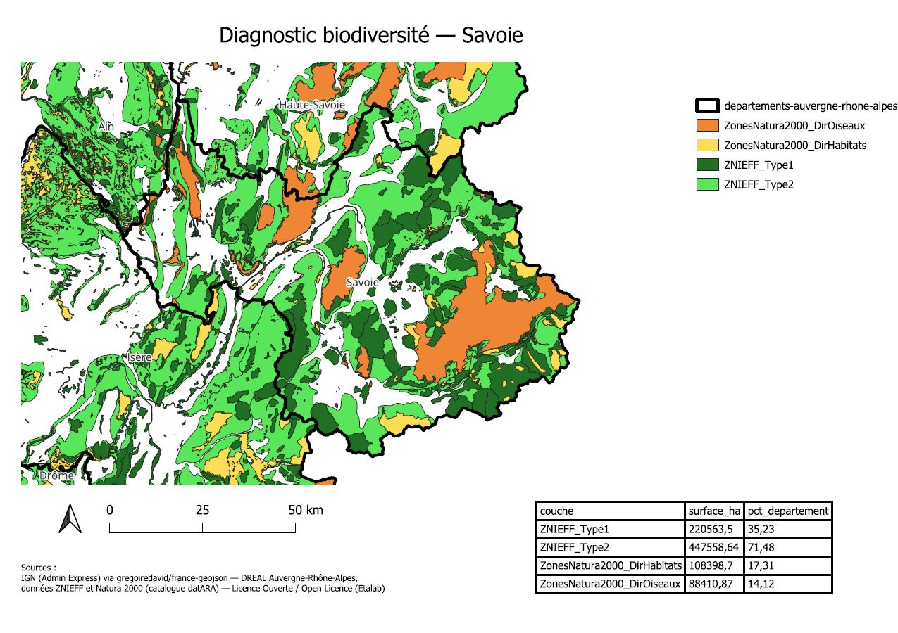
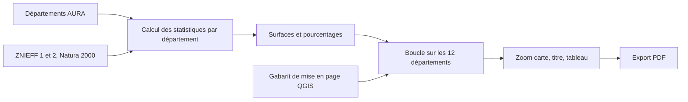

# Module 1 — Algorithme d’analyse de zonages protégés

**Statut : 🟢 version 1 fonctionnelle**

## Objectif
Algorithme de traitement QGIS (PyQGIS) qui, pour un territoire donné (une ou plusieurs communes d'Auvergne-Rhône-Alpes), identifie les zonages protégés qui le recoupent (ZNIEFF, Natura 2000) et calcule, **commune par commune**, la surface concernée et la part de la commune couverte.
 
L'outil s'intègre à la boîte à outils de traitements de QGIS : il s'utilise comme n'importe quel outil natif, avec sa fenêtre de paramètres, et peut être chaîné avec d'autres traitements ou lancé en lot.

## Fonctionnement



1. Les communes sélectionnées sont reprojetées en Lambert-93 (EPSG:2154), pour obtenir des surfaces en m².
2. Pour **chaque couche de zonage**, l'algorithme ne garde que les sites qui touchent le territoire, les reprojette, répare leurs géométries invalides, puis les découpe selon les limites des communes.
3. Les micro-polygones de moins de 1 m², artefacts de la superposition de deux sources dont les limites ne coïncident pas exactement, sont écartés.
4. Pour chaque morceau restant, l'algorithme calcule la surface en hectares et le pourcentage de la commune concernée, puis écrit le tout dans la couche de résultat.

## Architecture

```
src/algorithme_traitement/
└── zonages_proteges.py     # classe ZonagesProtegesAlgorithm (algorithme de traitement QGIS)
```
 
L'algorithme est une classe qui hérite de `QgsProcessingAlgorithm`. QGIS en déduit automatiquement la fenêtre de paramètres.
 
| Méthode | Rôle |
|---|---|
| `name`, `displayName`, `group`, `groupId`, `createInstance` | Identité de l'outil dans la boîte à outils (Scripts > Biodiversité AURA) |
| `initAlgorithm` | Déclare les paramètres d'entrée et de sortie |
| `processAlgorithm` | Traitement principal : lecture des entrées, boucle sur les zonages, écriture du résultat |
| `_executer` | Lance un outil natif de QGIS et renvoie toujours une couche. Conserve une référence aux couches temporaires pour éviter leur suppression prématurée en mémoire |
| `_premier_champ` | Repère la colonne de nom ou d'identifiant selon la couche (`nom`, `id_mnhn`, `cd_sig`, `code`...) |
| `_texte` | Convertit une valeur en texte en conservant les valeurs vides |
 
**Paramètres**
 
| Paramètre | Type | Description |
|---|---|---|
| `TERRITOIRE` | Polygones | Communes à analyser (la sélection d'entités est respectée) |
| `ZONAGES` | Couches de polygones | Une ou plusieurs couches de zonages |
| `SORTIE` | Couche de polygones | Couche temporaire produite |
 
**Couche de sortie** (MultiPolygon, Lambert-93)
 
| Colonne | Contenu |
|---|---|
| `couche` | Couche de zonage d'origine |
| `nom_site` | Nom du site |
| `id_site` | Identifiant du site (`id_mnhn` pour les ZNIEFF, `cd_sig` pour Natura 2000) |
| `commune` | Nom de la commune |
| `code_insee` | Code de la commune |
| `surface_ha` | Surface du morceau de site situé dans la commune (hectares) |
| `pct_commune` | Part de la commune couverte par ce morceau (%) |
 
Outils natifs de QGIS utilisés : `native:reprojectlayer`, `native:extractbylocation`, `native:fixgeometries`, `native:intersection`.

## Stack

- QGIS 3.40 LTR, Python 3.12
- PyQGIS : `QgsProcessingAlgorithm`, géométries, systèmes de coordonnées
- Processing QGIS : outils natifs de traitement

## Données
 
Les données sont à placer dans `data/raw/` (dossier ignoré par Git).
 
| Donnée | Source |
|---|---|
| Communes (ex : Savoie) | API Découpage administratif, `geo.api.gouv.fr` |
| ZNIEFF de type 1 et 2 | DREAL Auvergne-Rhône-Alpes, catalogue datARA |
| Natura 2000 (directives habitats et oiseaux) | DREAL Auvergne-Rhône-Alpes, catalogue datARA |
 
Toutes ces données sont sous Licence Ouverte (Etalab). La couche de territoire doit contenir un champ `nom` et un champ de code commune (`code`, `insee` ou `code_insee`).

## Utilisation

### Prérequis

- QGIS 3.40 LTR avec PyQGIS
- Le dossier `src/algorithme_traitement` ajouté dans `Préférences > Options > Traitement > Fournisseurs > Scripts`
- Les données téléchargées et placées dans `data/raw/` (voir section Données)

### Étapes

1. **Nettoyer le projet.** Avant toute exécution, vérifier qu'aucune couche résultant d'un essai précédent (nommée par défaut « Zonages recoupés ») n'est encore chargée dans le panneau des couches. La supprimer si besoin (clic droit > Supprimer la couche).

2. **Charger les données sources.** Glisser-déposer dans QGIS :
   - la couche du territoire (ex : `communes_73.geojson`)
   - les couches de zonages à analyser (ZNIEFF type 1, ZNIEFF type 2, Natura 2000 habitats, Natura 2000 oiseaux)

3. **Sélectionner le territoire d'étude.** Activer la couche de communes, utiliser l'outil « Sélectionner une entité » et cliquer sur la ou les commune(s) à analyser (surlignée(s) en jaune).

4. **Lancer l'outil.** Boîte à outils de traitements (`Ctrl+Alt+T`) > Scripts > Biodiversité AURA > *Zonages protégés d'un territoire*.

5. **Renseigner les paramètres :**
   - *Territoire* : la couche de communes, avec la case **« Entité(s) sélectionnée(s) uniquement »** cochée
   - *Couches de zonages* : cocher **uniquement** les couches sources (ne jamais inclure une couche de résultat d'un essai précédent)
   - *Zonages recoupés* : laisser « Créer une couche temporaire »

6. **Exécuter**, puis suivre l'avancement dans l'onglet Journal (une ligne « Traitement de : ... » par couche).

7. **Contrôler le résultat** dans la table attributaire de la couche produite : une ligne par site et par commune, avec un `pct_commune` plausible (entre 0 et 100).

## Exemple de résultat :

Zones Natura 2000 (directive oiseaux) :


Zones Naturelles d'Intérêt Ecologique Faunistique et Floristique de type 1 sur la Maurienne :


Résultat de l'algorithme (zonages recoupés) :


Table attributaire du résultat :


## Limites connues :

- **Pourcentage par commune** : il est calculé par rapport à chaque commune individuellement, et non sur l'ensemble du territoire. Un site qui chevauche deux communes produit deux lignes.
- **Esquilles** : les morceaux de moins de 1 m² sont ignorés, car ils proviennent de l'écart entre les limites des différentes sources.
- **Colonnes reconnues** : le nom et l'identifiant des sites ne sont lus que dans les colonnes `nom`, `id_mnhn` et `cd_sig`. Pour une autre couche, ces colonnes restent vides.
- **Couche temporaire** : la sortie n'est pas enregistrée automatiquement. Il faut l'exporter (clic droit > Exporter) pour la conserver.
- **Périmètre testé** : communes de Savoie.


# Module 2 — Fiches diagnostic départementales

**Statut : 🟢 version 1 fonctionnelle**

## Objectif

Générer automatiquement, pour chacun des **12 départements d'Auvergne-Rhône-Alpes**, une fiche PDF d'une page contenant :

- une **carte** du département, avec les zonages de protection de la biodiversité (ZNIEFF, Natura 2000) ;
- un **tableau de synthèse** : pour chaque type de zonage, la surface couverte (en hectares) et la part du département concernée (en %) ;
- la **source des données** et la licence.

Une seule commande produit les 12 fiches, sans ouvrir l'interface de QGIS.

## Exemple de résultat 

[](docs/exemples/fiche_73_Savoie.pdf)

*Cliquer sur l'image pour ouvrir le PDF.*

## Fonctionnement


1. **Calcul des statistiques** (`calcul_stats_departements.py`) : pour chaque département et chaque couche de zonage, le script extrait les sites qui le touchent, reprojette en Lambert-93 (EPSG:2154) pour obtenir des surfaces en m², répare les géométries invalides, découpe les sites par le contour du département et fusionne le résultat. Il en déduit la surface totale et le pourcentage du département couvert.
2. **Génération des fiches** (`generer_fiches_pdf.py`) : le script ouvre un projet QGIS qui contient une mise en page préparée à la main (le *gabarit*), puis, pour chaque département, zoome la carte sur son emprise, met à jour le titre, remplit le tableau avec ses statistiques et exporte le tout en PDF.

## Architecture

```
src/fiches_departements/
├── calcul_stats_departements.py   # calculs géospatiaux (retourne une liste de statistiques)
└── generer_fiches_pdf.py          # pilotage de la mise en page et export PDF
qgis/
└── gabarit_fiche.qgz              # projet QGIS : couches + mise en page « fiche_departement »
outputs/fiches/                    # PDF générés (ignorés par Git)
docs/exemples/                     # exemples de fiches pour la documentation
```

Le gabarit est construit **à la main** dans QGIS (disposition, police, légende, échelle, boussole). Le script ne dessine rien : il pilote trois éléments identifiés par leur Id.

| Élément | Id attendu | Rôle |
|---|---|---|
| Carte | `carte_principale` | zoomée sur chaque département |
| Étiquette | `titre` | nom du département |
| Tableau attributaire | `tableau_stats` | statistiques du département |

## Stack

- QGIS 3.40 LTR, Python 3.12
- PyQGIS : projet, mise en page (`QgsLayout`), export (`QgsLayoutExporter`)
- Processing QGIS : outils natifs (`native:intersection`, `native:dissolve`, etc.)

## Données

Les données sont à télécharger dans `data/raw/` (dossier ignoré par Git).

| Donnée | Source | Nom de la couche dans le projet |
|---|---|---|
| Contours des départements | IGN (Admin Express), via [gregoiredavid/france-geojson](https://github.com/gregoiredavid/france-geojson) | `departements-auvergne-rhone-alpes` |
| ZNIEFF de type 1 | DREAL AURA, catalogue datARA | `ZNIEFF_Type1` |
| ZNIEFF de type 2 | DREAL AURA, catalogue datARA | `ZNIEFF_Type2` |
| Natura 2000, directive habitats | DREAL AURA, catalogue datARA | `ZonesNatura2000_DirHabitats` |
| Natura 2000, directive oiseaux | DREAL AURA, catalogue datARA | `ZonesNatura2000_DirOiseaux` |

Toutes ces données sont sous **Licence Ouverte (Etalab)**. Les noms de couches ci-dessus doivent être respectés dans le projet QGIS, car le script retrouve les couches par leur nom.

## Utilisation

**Prérequis** : QGIS 3.40 LTR (Windows).

1. Télécharger les données (voir ci-dessus) dans `data/raw/`.
2. Vérifier que `qgis/gabarit_fiche.qgz` s'ouvre avec toutes les couches chargées. Si besoin, réattacher les chemins vers `data/raw/`.
3. Si QGIS n'est pas installé dans `C:\Program Files\QGIS 3.40.15`, adapter le chemin dans le bloc `__main__` de `generer_fiches_pdf.py`.
4. Depuis un invite de commandes :

```
"C:\Program Files\QGIS 3.40.15\bin\python-qgis-ltr.bat" "<chemin du repo>\src\fiches_departements\generer_fiches_pdf.py"
```

Les fiches sont créées dans `outputs/fiches/`, sous la forme `fiche_<code>_<département>.pdf`.

> Ne pas enregistrer le projet `.qgz` après un lancement depuis la console QGIS : le script peut y modifier l'état de la mise en page.

## Limites connues 

- **Contours simplifiés** : les contours départementaux du dépôt utilisé sont simplifiés pour alléger les fichiers. Les pourcentages sont donc très légèrement approximatifs près des limites.
- **Chevauchements** : ZNIEFF et Natura 2000 se superposent en partie. Les pourcentages des quatre lignes du tableau ne s'additionnent donc pas.
- **Gabarit manuel** : la mise en page est préparée dans l'interface de QGIS. Le script dépend des noms de couches et des Id d'éléments décrits plus haut.
- **Données figées** : les zonages sont ceux téléchargés à une date donnée, sans mise à jour automatique.
- **Environnement testé** : Windows et QGIS 3.40 LTR uniquement.

## Pistes d'évolution

- Fusionner les 12 PDF en un atlas unique.
- Rendre le chemin d'installation de QGIS configurable.
- Ajouter une fiche à l'échelle d'une commune, en réutilisant le module 1.
